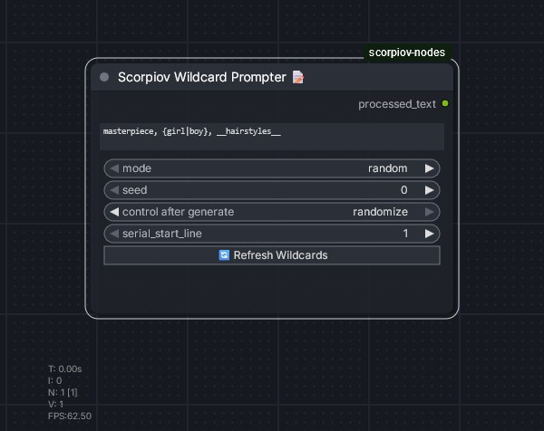
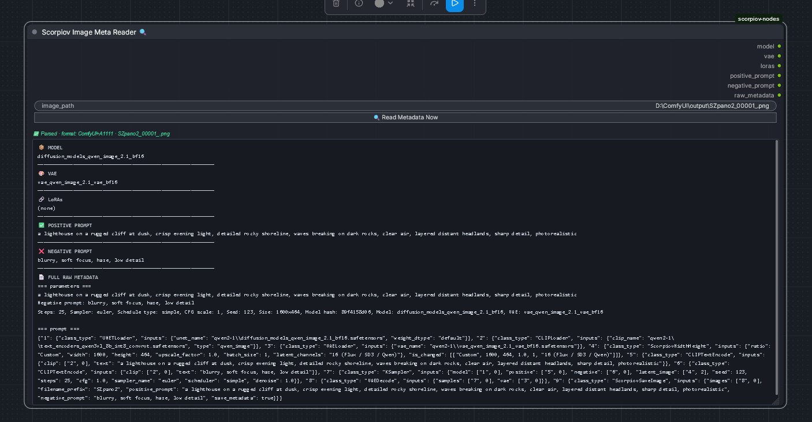
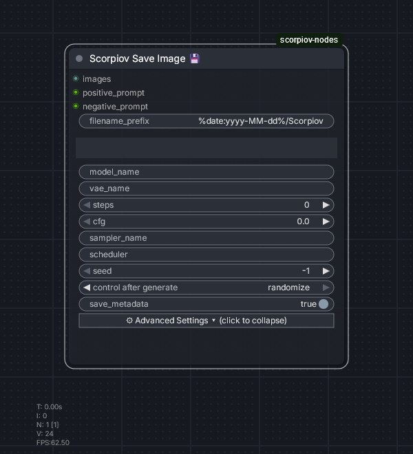
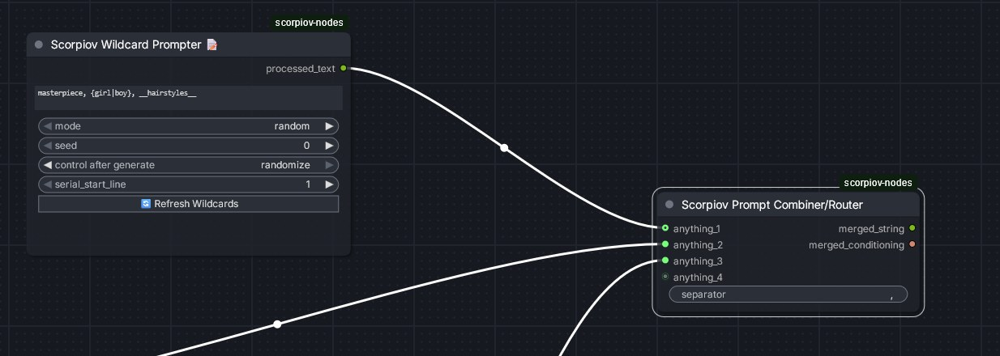
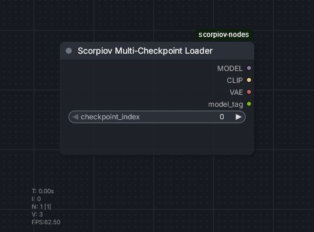
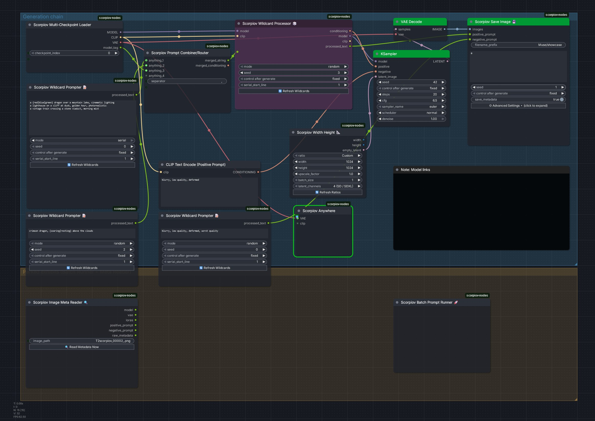
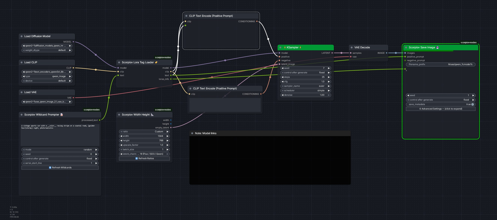

# scorpiov-nodes

A collection of custom ComfyUI nodes I use in my own workflows — wildcard prompting, LoRA tag loading, Civitai-ready image saving with automatic metadata, graph-wide broadcast connections, and weighted prompt/conditioning merging.

## Installation

1. Download or clone this repo into `ComfyUI/custom_nodes/scorpiov-nodes/`
2. Restart ComfyUI

No extra Python dependencies beyond what ComfyUI already ships with.

## Nodes

| Node                    | Category         | What it does                                                                                 |
| ----------------------- | ---------------- | -------------------------------------------------------------------------------------------- |
| Wildcard Processor 🎲    | Scorpiov/Prompt  | Resolves wildcards + inline `{a\|b\|c}` groups, loads `<lora:...>` tags, outputs CONDITIONING |
| Wildcard Prompter 📝     | Scorpiov/Prompt  | Text-only version — no model/clip needed, just resolves wildcards to a string                |
| Lora Tag Loader 🏷️      | Scorpiov/Loaders | Reads `<lora:name:weight>` tags out of any text, loads them onto model/clip, strips the tags |
| Width Height            | Scorpiov/Latent  | Aspect ratio picker for empty latents                                                        |
| Image Meta Reader 🔍     | Scorpiov/Image   | Reads A1111 and ComfyUI-native PNG metadata back out of an image                             |
| Image Loader 🖼️         | Scorpiov/Image   | Loads an image, also outputs its filename and full path                                      |
| Save Image 💾            | Scorpiov/Image   | Saves images with full Civitai-compatible metadata, auto-detected from your workflow         |
| Scorpiov Anywhere 📡     | Scorpiov/Routing | Broadcasts a connection to every matching, unconnected input in the graph — no wires needed  |
| Prompt Combiner/Router 🔀 | Scorpiov/Routing | Merges multiple STRING and/or CONDITIONING inputs into one output each, with per-input weight and enable/disable |
| Multi-Checkpoint Loader | Scorpiov/Loaders | Holds several checkpoints (each with a short tag); loads one by index and also outputs its tag |
| Batch Prompt Runner 🚀 | Scorpiov/Batch   | Control panel (not wired to anything) that queues every checkpoint × prompt-line combination for you |

---

### Wildcard Processor 🎲

All-in-one wildcard processor with LoRA loading, serial/random modes, and prompt preview.

- Put your wildcard `.txt` files into the `wildcards/` folder in the node folder — any subfolder depth, just reference by filename with `__filename__` (no path needed)
- Supports inline `{option_a|option_b|option_c}` groups, including nested
- Random or Serial selection mode; Serial remembers position and loops
- Parses and loads `<lora:name:weight>` tags found in the resolved text directly onto the model/clip
- Outputs CONDITIONING, MODEL, CLIP, and the resolved STRING
- **Comments** are supported both in wildcard `.txt` files and typed directly into the node's own text box — see [Comments](#comments) below
- A live **🎨 Highlighted Preview** box sits under the text field, color-coding `{ }` groups, `( )` weights, `:weight` numbers, and comments as you type — read-only, just a visual aid

*Generated live with this pack: the typed prompt was `a majestic __color__ dragon, {breathing fire|sleeping}, cinematic lighting` — the Processor resolved it to "a majestic blue dragon, sleeping, cinematic lighting", which is also exactly what Save Image embedded and Image Meta Reader read back.*

### Wildcard Prompter 📝

Text-only variant of the Wildcard Processor — no `model`/`clip` inputs, no LoRA loading. Just resolves wildcards and outputs the string, so you can feed it into a Lora Tag Loader or CLIPTextEncode. Useful when you want to build your prompt text before deciding what to do with it. Same comment support and Highlighted Preview as the Wildcard Processor.

*The Prompter at its default size. The October 2026 UI keeps the resolved-prompt preview at a fixed height (scrollable, with character count and a Copy button) instead of letting the node grow with the text.*

#### Comments

Both wildcard nodes, and the `.txt` files they load from `wildcards/`, support two comment styles:

- `# comment` — everything from a `#` to the end of that line is dropped. Works on its own line, or trailing after real text (`blonde hair # my favorite`). If you need a literal `#` in your prompt (hex colours like `#FF0000`), escape it as `\#`.
- `/* comment */` — block comments, C-style. Can span multiple lines, and the markers don't need to sit alone on their own line — `/* this` on one line and `is a comment */` two lines later works exactly like you'd expect from any C-style comment.

Comments are stripped before wildcards or `{a|b|c}` groups are resolved, so they never reach the resolved prompt, Save Image, or embedded PNG metadata.

### Lora Tag Loader 🏷️

Reads `<lora:name:weight>` or `<lora:name:weight:clip_weight>` tags out of a text prompt (e.g. from Wildcard Prompter), loads each named LoRA onto the given model/clip, and strips the tags out of the text so it's safe to feed into a standard `CLIPTextEncode` node.

- `<lora:name:0.8>` → same weight applied to both the model and CLIP
- `<lora:name:0.8:0.6>` → separate model weight (0.8) and CLIP weight (0.6), matching how [comfyui_lora_tag_loader](https://github.com/badjeff/comfyui_lora_tag_loader) handles it **(Shoutout and thanks to badjeff for an amazing node).**
- Searches every folder registered under ComfyUI's `loras` path, matched by filename — subfolders in your LoRA library "just work," and a subfolder prefix inside the tag itself (e.g. `<lora:MyFolder\mylora:0.8>`) is handled too
- Outputs: `model`, `clip`, `text` (tags stripped, ready for CLIPTextEncode), and `loras_info` — a formatted string with each LoRA's name, weight, and content hash, meant to be wired straight into **Save Image**'s `loras` input for Civitai-compatible metadata

Typical chain: `Wildcard Prompter` → `Lora Tag Loader` → two `CLIPTextEncode` nodes (positive/negative) → `KSampler`, with `loras_info` also wired to `Save Image`.

### Width Height

Aspect Ratio Node, set width/height for empty latents or choose from a list
- Add to the list by updating the `ratios.txt` file in the node folder
  - Eg: `My Custom Ratio (2:1) | 2048 | 1024`
- The `latent_channels` input picks the latent format: `4 (SD / SDXL)` or `16 (Flux / SD3 / Qwen)`. In 16-channel mode, dimensions snap down to a 16-pixel grid with a console note (e.g. `1000 x 832 -> 992 x 832`) — those models pack latents 2x2 and floor non-conforming sizes anyway, so the sizes this node reports are the sizes you actually get.

*A custom 1600×464 frame (Qwen-Image 2.1, 16-channel latent) — generated at exactly the requested size.*

### Image Meta Reader 🔍

Reads PNG metadata in both A1111 and ComfyUI-native JSON formats — model, VAE, LoRAs, prompts, and the full raw metadata — into a single scrollable textarea. Has a "Read Metadata Now" button so you can inspect an image without running the whole workflow.

When an image carries both formats (e.g. anything saved by this pack's Save Image), the reader shows the prompt that was **actually executed** — resolved wildcards and all — taken from the A1111 parameters block, not the as-typed template stored in the ComfyUI graph. A bare filename works too: input, output, and temp folders are all searched.

*The reader after a run — here it's reading back the 1600×464 panorama from the Width Height section below: model, VAE, the executed prompt, and the full raw metadata (note the real `Model hash: 89f4158d06` in the parameters block).*

### Image Loader 🖼️

Loads an image and outputs the tensor, the bare filename, and the full file path — handy when a downstream node needs to know exactly which file it's working with.

### Save Image 💾

Saves images with full A1111/Civitai-compatible metadata embedded in the PNG.

- **Required wires:** `images`, `positive_prompt`, `negative_prompt`
- **`loras`** is also a wire-only input (no typed-text fallback) — connect it from Lora Tag Loader's `loras_info` output, or Image Meta Reader's `loras` output. Leave it unconnected to skip LoRA metadata entirely.
- **Everything else is auto-detected** from your workflow graph — steps, CFG, sampler, scheduler, seed, checkpoint name, and VAE name are all read automatically. Typing a value into any of those fields overrides the auto-detected one.
- **⚙ Advanced Settings** collapses `model_name`, `vae_name`, `steps`, `cfg`, `sampler_name`, and `scheduler` behind a toggle button, collapsed by default, since these usually only matter when overriding auto-detection. `seed` and `save_metadata` stay visible. (There is no `model_hash` field — the hash is always computed from the actual model file, see below.)
- **LoRA + Civitai badges:** wire `Lora Tag Loader`'s `loras_info` output into the `loras` input, and Save Image will embed the `<lora:name:weight>` tag and a proper `Lora hashes:` line so Civitai can recognize and badge the LoRAs used.
- **Model hash:** the checkpoint file is automatically hashed (SHA256 → Civitai's "AutoV2" short hash) and embedded as `Model hash:`. UNETLoader-based workflows (Flux, Qwen) are detected and hashed the same way, and LoRAs are also picked up from standard `LoraLoader` nodes in the graph — no placeholder hashes are ever written.

*Saved by this node during live testing (Qwen-Image 2.1 via UNETLoader). The PNG's embedded metadata carries the real AutoV2 model hash, sampler settings, and the executed prompt.*
- **Hashing is cached**, keyed by file content (not filename or path), so a given checkpoint or LoRA is only ever hashed once — after that, saves reuse the cached hash instantly. The cache lives at `scorpiov-nodes/.scorpiov_hash_cache.json`; delete it any time to force a clean re-hash of everything.
- `filename_prefix` supports subfolders via `/`, date tokens like `%date:yyyy-MM-dd%`, and the tokens `%seed%`, `%model%`, `%width%`, `%height%`. Batch saves share the one resolved prefix and differ only by the sequential counter.

*Save Image with Advanced Settings collapsed — the auto-detected fields stay out of the way until you need to override one.*

### Scorpiov Anywhere 📡

A broadcast/connector node — plug something in once, and it becomes available to every other matching, unconnected input in the graph, without drawing a wire to each one by hand. Inspired by [cg-use-everywhere](https://github.com/chrisgoringe/cg-use-everywhere)'s "Anything Everywhere," rebuilt independently for reliability on newer Vue-based ComfyUI frontends. **Shoutout and thanks to chrisgoringe**

- **Dynamic inputs** — connect one thing or ten; a fresh empty `anything_N` slot appears automatically as each one fills.
- **Auto-labeling** — each connected slot is labeled from its source (`MODEL`, `CLIP`, `VAE`, ...) automatically, for readability.
- **Any-node broadcasting** — right-click any node → "Add Scorpiov Broadcasting" to broadcast its outputs directly, without routing through a dedicated node.
- **Type + name matching with priority** — an unconnected input is filled by the best-scoring match (exact name match beats type-only match). Genuine ties — e.g. two same-typed sources with nothing to disambiguate them (two `CONDITIONING` outputs, or several `STRING` fields) — are skipped and logged rather than guessed.
- **Manual disambiguation** — right-click any input dot on a Scorpiov Anywhere node → "Rename for Scorpiov matching..." to give it a specific name (e.g. `positive` / `negative`) so it matches the right target when more than one source shares a type. This persists with the saved workflow.
- **Cycle-safe** — before accepting a match, the engine checks whether it would create a dependency loop through the graph's existing connections, and skips it (with a log message) rather than producing an unrunnable prompt.
- **Selection-based wire visualizer** — select a Scorpiov Anywhere (or broadcast-flagged) node to see faint dashed lines to everything it feeds; select any fed node to see a line back to its broadcaster. Nothing is drawn unless something is selected.
- Resolves entirely at prompt-submission time by rewriting the serialized graph before it's sent for execution — the node itself never reaches the backend, so there's no runtime cost, but it also means broadcast connections never appear as real wires on the canvas. Use the visualizer, or check the browser console for skipped-match warnings, to confirm what actually got connected.

---

### Prompt Combiner/Router 🔀

Merges multiple STRING and/or CONDITIONING inputs into one merged STRING output and one merged CONDITIONING output, with per-input weight and enabled/disabled control. Sits naturally between `Wildcard Prompter` and `Lora Tag Loader` when plain concatenation isn't giving you enough control over how prompt fragments combine.

- **Dynamic inputs** — same `anything_N` growth pattern as Scorpiov Anywhere; wire in as many STRING and/or CONDITIONING sources as you want, in any mix.
- **Auto-routing by type** — no need to tell it what's connected. STRING inputs feed `merged_string`, CONDITIONING inputs feed `merged_conditioning`, automatically, per connection.
- **Per-input weight and enable/disable** — right-click any connected slot → "Set weight..." or "Enable/Disable this input". Settings persist with the saved workflow.
  - For **STRING** inputs, weight is expressed using ComfyUI's own prompt-emphasis syntax (`(fragment:0.60)`), so it directly affects generation strength through a standard `CLIPTextEncode` — text itself has no numeric "blend," so this is how weight actually does something for the STRING path.
  - For **CONDITIONING** inputs, weight drives a genuine weighted average across every connected input's tensor *and* pooled_output (matching how ComfyUI's own `ConditioningAverage` node treats its strength parameter, generalized here to N inputs instead of 2).
- `separator` controls how merged STRING fragments are joined (default `, `).

> **A note on `merged_conditioning`:** averaging conditioning tensors works well for gently nudging between *similar* prompts, but has a real ceiling for very different scenes — at equal weight, one prompt's content can dominate almost entirely, with barely a trace of the other. This is confirmed against ComfyUI's own built-in `ConditioningAverage` node behaving identically, not a limitation specific to this node. For blending two very different scenes, merging as STRING and running the combined text through a single `CLIPTextEncode` is usually the more reliable route to an actual blend.

Typical chain: `Wildcard Prompter` → **Combiner/Router** → `Lora Tag Loader` → `CLIPTextEncode`.

*Prompters wired into a Combiner — the first input is shown; two more arrive from Prompters just out of frame.*

---

### Multi-Checkpoint Loader

Holds a list of checkpoints, each with a short tag, and loads one of them by `checkpoint_index`. Outputs `MODEL`, `CLIP`, `VAE`, and `model_tag` — the selected checkpoint's tag, defaulting to its clean filename (no folder, no extension). Slots are configured in the node's panel and persist inside the saved workflow. Built to pair with the Batch Prompt Runner, which drives the index for you.

### Batch Prompt Runner 🚀

A control panel, not a graph node — it is never wired to anything. It finds the Wildcard Prompter, Multi-Checkpoint Loader, and Save Image nodes already in your graph and submits one queue job per (checkpoint × prompt line) combination: for each checkpoint it walks the prompter's prompt list line by line (serial mode), naming each output `{line:03d}-{tag}` via Save Image's `filename_prefix`. One click turns "try this prompt set on all my checkpoints" into a single batch.

---

## Example workflows

Two ready-to-load workflows live in [`examples/`](examples/) — drop either JSON onto the ComfyUI canvas. Checkpoint/LoRA names inside them point at the author's own library, so swap those for yours.

**Showcase (SDXL)** — [`examples/scorpiov-showcase.json`](examples/scorpiov-showcase.json): a Multi-Checkpoint Loader feeds three Prompters merged by a Prompt Combiner into a Wildcard Processor, with Scorpiov Anywhere broadcasting the VAE and Save Image wired for full metadata. The Batch Prompt Runner and Image Meta Reader sit parked below the main chain as exhibits.

**Qwen Wildcard Template** — [`examples/qwen-wildcard-template.json`](examples/qwen-wildcard-template.json): a minimal Qwen-Image 2.1 chain — Prompter → Lora Tag Loader → CLIPTextEncode, Width Height in 16-channel mode (1344×768), 25 steps at CFG 1, and Save Image writing to `Claude/qwen_%model%` with `loras_info` wired for Civitai badges.

---

## October 2026 fix pass

A full-pack correctness pass (every fix verified live in ComfyUI, including real generations on SDXL, Anima, and Qwen-Image 2.1). Highlights — the full changelog is in [FIXES.md](FIXES.md):

- **Image Meta Reader** shows the prompt that was actually executed, and finds images by bare filename again
- **Save Image** writes real model/LoRA hashes (no more placeholders), detects UNETLoader workflows, and records CFG unrounded
- **Wildcard nodes** no longer reseed Python's global RNG; serial mode survives wildcard files being edited shorter; LoRA indexes are cached instead of rebuilt every run
- **Wildcard Prompter** UI rebuilt: fixed-height scrollable preview (no more ballooning), character count, Copy button
- **Scorpiov Anywhere** broadcast flags now survive workflow save/reload
- One broken node file can no longer take the whole pack down at load time

---

## Notes

- All LoRA-aware nodes search every folder registered under ComfyUI's `loras` path — you don't need to configure anything, just drop LoRA files anywhere under your usual loras directory (subfolders included).
- Metadata written by Save Image is readable by Automatic1111, Civitai, and this package's own Image Meta Reader.
- The `wildcards/` folder in this repo ships with two small curated files — `art_styles.txt` (24 art styles) and `realism_styles.txt` (18 photography/realism styles) — to illustrate the format — the author's full wildcard library is not included (and this repo is not a backup of it).
- Built and tested against ComfyUI's newer Vue-based frontend. If you're on the older classic frontend, the JS-side UI extras (Highlighted Preview, Advanced Settings toggle, Scorpiov Anywhere's visualizer and rename menu) should still work, but haven't been explicitly tested there.
- Scorpiov Anywhere's Image Meta Reader compatibility: since broadcast connections aren't real graph wires, Image Meta Reader's graph-walking (which follows real links) currently won't see prompts/LoRAs delivered via a broadcast — wire those directly if you need them to show up in embedded metadata.
